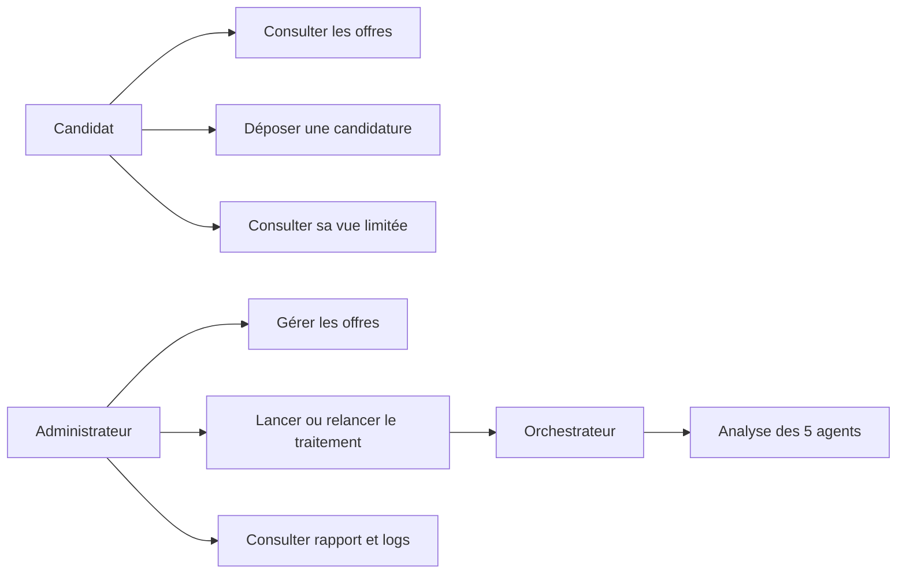
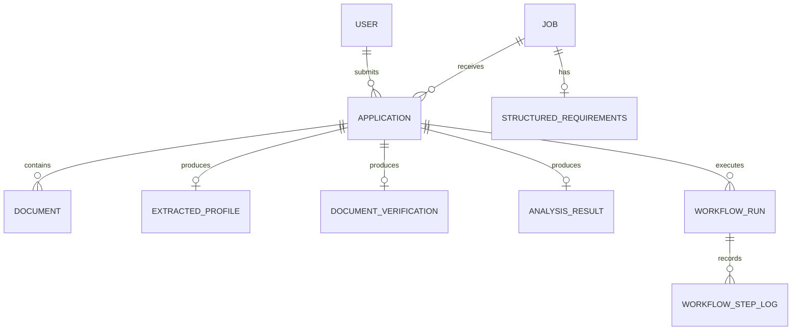
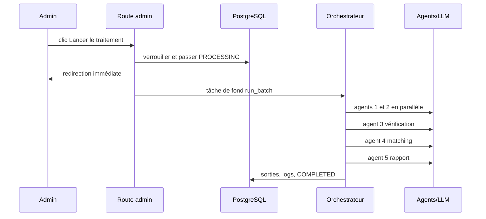
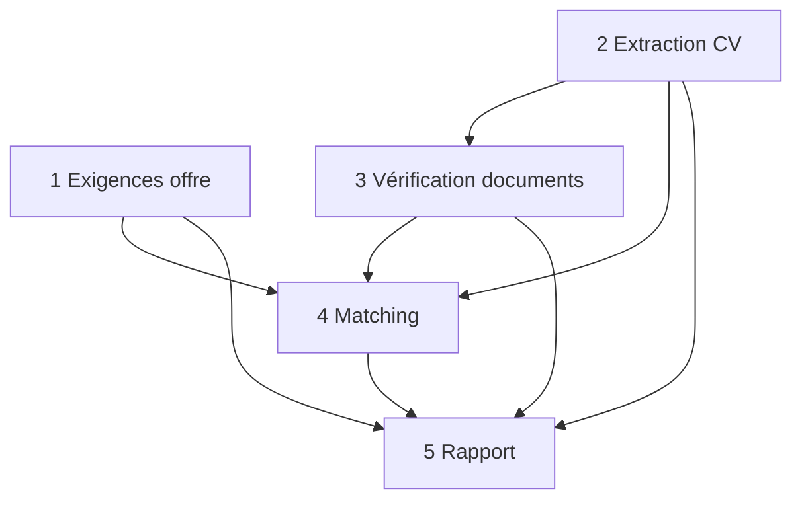

# Architecture et diagrammes

## Cas d'utilisation

## Modèle de données

## Workflow de bout en bout

## Cinq agents et dépendances

Agents 1 et 2 sont concurrents ; les autres suivent l'ordre imposé.
