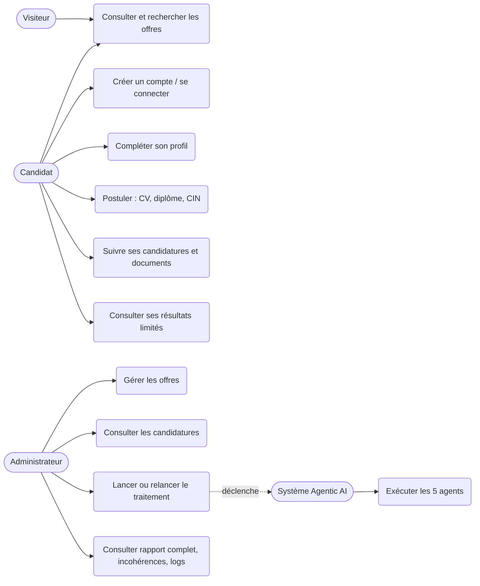
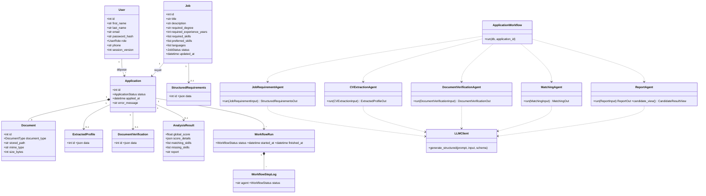
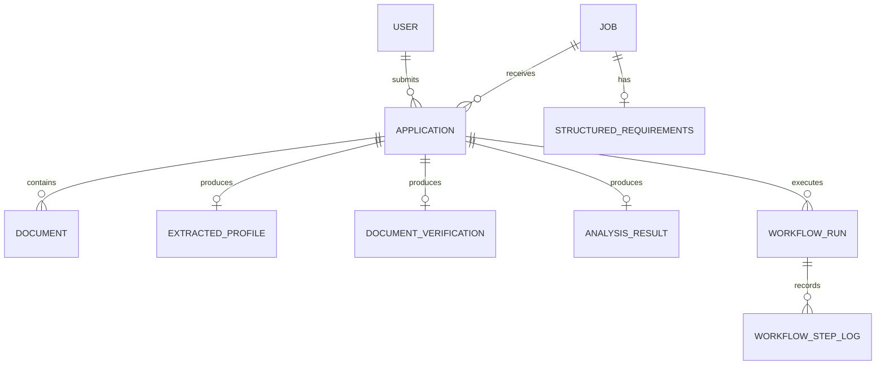
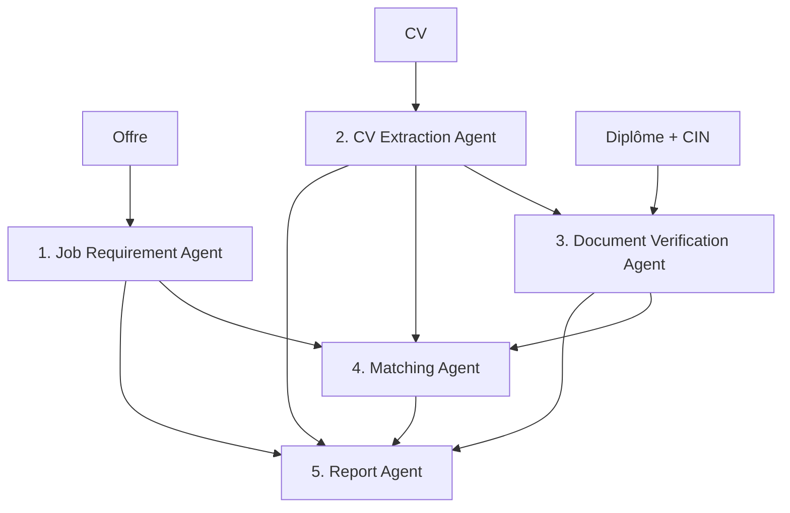

# Rapport technique : plateforme de recrutement Agentic AI (matching CV ↔ offre)

Mini-projet 2, module Intelligence Artificielle / Agentic AI.
Ce rapport décrit le projet **tel qu'il est implémenté dans ce dépôt**. Chaque affirmation
renvoie à un fichier ou à un test. Les éléments non réalisés ou non vérifiés sont signalés
explicitement dans les sections 14 et 15.

## 1. Analyse des besoins

Les recruteurs reçoivent beaucoup de candidatures et doivent lire les CV, vérifier les
justificatifs et comparer chaque profil aux exigences du poste. La plateforme automatise cette
préparation sans jamais décider à la place du recruteur.

| Acteur | Besoins |
|---|---|
| Administrateur (recruteur) | Gérer les offres, consulter les candidatures, **déclencher** le traitement IA, lire le rapport complet |
| Candidat | Consulter les offres, créer un compte, postuler avec CV, diplôme et CIN, suivre ses candidatures, lire les résultats qui lui sont destinés |
| Visiteur | Consulter et rechercher les offres publiées |
| Système Agentic AI | Exécuter le workflow des cinq agents après déclenchement par l'administrateur |

Exigences non fonctionnelles : sécurité (mots de passe hachés, contrôle d'accès par rôle,
validation des fichiers), protection des données sensibles (CIN, diplômes), traitement
asynchrone, fiabilité (statut d'erreur et relance), explicabilité du score, ergonomie.

## 2. Cahier des charges et traçabilité

| Exigence du cahier des charges | Implémentation | Preuve |
|---|---|---|
| Offres : brouillon, publication, modification, clôture | `app/api/admin_jobs.py` | `tests/test_admin_jobs.py`, `tests/test_robustness.py` |
| Site public : liste, recherche, détail | `app/api/public_jobs.py` | `tests/test_public_jobs.py` |
| Parcours de candidature (compte, profil, 3 documents, confirmation) | `app/api/applications.py`, `app/services/document_storage.py` | `tests/test_applications.py` |
| Statut « En attente de traitement » + 2 emails | `app/services/email_service.py` | `tests/test_email_service.py` |
| **Aucune analyse automatique** | `confirm_application` s'arrête à `PENDING` | `test_complete_application_is_pending_without_workflow` |
| Lancer le traitement (sélection multiple), relancer | `POST /admin/applications/process`, `/{id}/retry` | `tests/test_admin_process_http.py` |
| Cinq agents, sorties JSON validées, orchestrateur, logs | `app/agents/`, `app/orchestration/workflow.py` | `tests/test_workflow_integration.py` |
| Score pondéré et rapport explicable | `app/agents/matching.py`, `app/agents/report.py` | `tests/test_matching_agent.py` |
| Espace candidat : résultats limités | `app/api/candidate.py` | `tests/test_robustness.py`, `tests/test_candidate_space.py` |
| Statuts, erreur, relance | `app/services/application_state.py` | `tests/test_application_state.py`, `tests/test_workflow_integration.py` |
| Jeu de test : 2 offres, 5 candidatures, 1 incohérence | `app/demo_data.py`, `app/seed.py`, `data/fixtures/` | `test_seed_is_idempotent_and_creates_required_dataset` |

## 3. Diagramme de cas d'utilisation



## 4. Diagramme de classes UML



## 5. Modèle de données (MCD)



Clés et contraintes : voir `migrations/versions/`. Les sorties d'agents sont en colonnes JSON.
`structured_requirements.job_id` est unique (une ligne par offre). Le schéma est reproductible :
`alembic upgrade head` sur une base vierge, puis `alembic check` ne détecte aucune dérive
(vérifié, section 13).

## 6. Diagramme de séquence du workflow

```mermaid
sequenceDiagram
  actor Cand as Candidat
  actor Adm as Administrateur
  participant API as API FastAPI
  participant DB as PostgreSQL
  participant WF as ApplicationWorkflow
  participant LLM as Fournisseur LLM
  Cand->>API: Confirme la candidature + 3 documents
  API->>DB: Application = PENDING
  API-->>Cand: Email de confirmation
  API-->>Adm: Email de notification
  Note over API,WF: Aucune analyse n'est lancée
  Adm->>API: Sélectionne et clique « Lancer le traitement »
  API->>DB: Application = PROCESSING + WorkflowRun PENDING (même transaction)
  API-->>Adm: 303, retour immédiat (tâche de fond)
  par Agents 1 et 2 en parallèle
    WF->>LLM: Job Requirement Agent
    WF->>LLM: CV Extraction Agent
  end
  WF->>LLM: Document Verification Agent (dépend de 2)
  WF->>LLM: Matching Agent (dépend de 1, 2, 3)
  WF->>LLM: Report Agent (dépend de 1 à 4)
  WF->>DB: Résultats + logs ; Application = COMPLETED
  Note over WF,DB: En cas d'échec : ERROR + message, relance possible
```

## 7. Architecture technique

| Couche | Choix |
|---|---|
| Frontend | Templates Jinja2 rendus côté serveur (responsive) |
| Backend / API | Python 3.13, FastAPI |
| Base de données | PostgreSQL 16, SQLAlchemy 2, Alembic |
| Agents / orchestration | Orchestrateur développé en interne (`app/orchestration/workflow.py`) |
| LLM | Client multi-fournisseurs (`app/services/llm.py`), transport injectable |
| Lecture des documents | pdfplumber / PyPDF, python-docx, OCR Tesseract optionnel |
| Tâches asynchrones | `BackgroundTasks` FastAPI, concurrence bornée pour les lots |
| Emails | SMTP via aiosmtplib |
| Authentification | Cookie de session signé, Argon2, CSRF |
| Déploiement | Docker / Docker Compose |

Choix du transport injectable : les tests exécutent les vrais agents et le vrai orchestrateur
avec un faux fournisseur, sans réseau et sans clé d'API.

## 8. Architecture des cinq agents



Principes : une responsabilité par agent, un prompt dédié (`app/agents/prompts/`), des
entrées et sorties Pydantic avec `extra="forbid"`, un orchestrateur qui suit l'état, journalise
chaque étape (`WorkflowStepLog`) et gère les erreurs.

## 9. Description des agents

| N° | Agent | Rôle | Particularités vérifiées par des tests |
|---|---|---|---|
| 1 | Job Requirement | Exigences de l'offre → JSON | Le diplôme est facultatif ; le LLM ne peut pas en inventer un (`test_job_requirement_agent.py`) |
| 2 | CV Extraction | CV PDF/DOCX → profil JSON | Texte du CV encadré comme **non fiable** ; aucun champ genre, âge ou photo dans le schéma |
| 3 | Document Verification | Extrait diplôme et CIN, compare au CV | L'extraction est faite par le LLM, la **comparaison est déterministe** ; distingue identité, titulaire du diplôme, intitulé, année, information manquante, document illisible |
| 4 | Matching | Évalue les critères, calcule le score | **Contrat de critères** : liste exacte transmise au LLM, validée, relance contrôlée ; score déterministe |
| 5 | Report | Rapport explicable | Reprend exactement les scores calculés ; refuse toute donnée sensible ; rappelle que la décision est humaine |

### Contrat de critères du Matching Agent

L'orchestrateur calcule la liste exacte des identifiants attendus à partir des exigences :
`degree` (si un diplôme est exigé), `required_skill:<x>`, `preferred_skill:<x>`,
`language:<x>`. Cette liste est transmise au LLM dans `<criteres_attendus>`. La réponse est
rejetée si un identifiant manque, est inconnu ou en double. Une seule nouvelle tentative est
faite, avec le message d'erreur. Au-delà, l'agent échoue et la candidature passe en
`ERROR` : **un critère absent n'est plus jamais compté silencieusement comme un échec**.
Les critères d'expérience et de cohérence documentaire sont calculés par du code.

## 10. Prompts et schémas JSON

Les prompts complets sont dans [`annexes/PROMPTS.md`](annexes/PROMPTS.md) et les schémas JSON
des entrées et sorties dans [`annexes/SCHEMAS.md`](annexes/SCHEMAS.md). Ces deux fichiers sont
**générés depuis le code** par `scripts/generate_docs_annexes.py` pour ne pas diverger.

## 11. Méthode de calcul du score et justification des pondérations

Détail dans [`SCORING.md`](SCORING.md). Pondérations par défaut (celles du cahier des charges,
configurables par variables d'environnement, somme contrôlée à 100) :

| Critère | Poids | Justification |
|---|---:|---|
| Compétences obligatoires | 40 % | Condition d'éligibilité principale du poste |
| Expérience | 20 % | Mesurable et peu ambiguë (`min(années / exigées, 1)`) |
| Diplôme / formation | 15 % | Souvent substituable par l'expérience |
| Compétences souhaitées | 10 % | Atout, jamais bloquant |
| Langues | 5 % | Rarement discriminant |
| Cohérence des documents | 10 % | Signal de fiabilité du dossier, complété par une « revue humaine obligatoire » |

Un critère sans exigence (par exemple offre sans diplôme) est exclu et son poids est redistribué
proportionnellement. Pour une même entrée, le score est identique à chaque exécution
(`test_score_is_deterministic_and_reproducible`).

## 12. Sécurité et protection des données

Voir [`SECURITY.md`](SECURITY.md). Points vérifiés par des tests : isolation entre candidats,
rapport complet réservé à l'administrateur, CSRF stable entre onglets mais toujours exigé,
révocation de session à la déconnexion, cookies `HttpOnly`, `Secure` hors développement,
expiration de session, masquage du numéro de CIN et de la date de naissance avant les agents 4 et 5.
Le jeu de démonstration est entièrement fictif (numéros `ZZ00000x`, mention « SPÉCIMEN FICTIF »).

## 13. Tests réellement exécutés

Exécution du 07/11/2026 dans un conteneur Linux avec PostgreSQL 16 local :

| Vérification | Résultat |
|---|---|
| `pytest` (suite complète) | **145 réussis, 2 ignorés, 0 échec** (deux exécutions consécutives identiques) |
| Ignorés | `tests/test_real_llm_integration.py` et `tests/test_real_http_workflow.py` : appels à un vrai fournisseur facturables, opt-in (`RUN_REAL_LLM_TESTS=1`). **Ils ne comptent donc pas comme preuve.** |
| `ruff check .` et `ruff format --check .` | Sans erreur |
| `pip check` | Aucune dépendance cassée |
| `alembic upgrade head` sur base vierge, `alembic check`, downgrade puis upgrade | Réussis, aucune dérive de schéma |
| `python -m app.cli seed-demo` exécuté deux fois | 1re exécution : 6 utilisateurs, 2 offres, 5 candidatures, 15 documents ; 2e : 0 création |
| `docker compose config` | Valide (avec un `.env` de test) ; `build` et `up` **non exécutés** (section 14) |

Répartition (nombre de tests par fichier) : voir `pytest --collect-only -q`. Les fichiers ajoutés
pour la remise en conformité : `test_matching_agent.py` (17), `test_job_requirement_agent.py` (3),
`test_document_verification_agent.py` (10), `test_cv_extraction_and_report_agents.py` (10),
`test_workflow_integration.py` (17, dont parallélisme des agents 1 et 2, dépendances, erreur de
chaque agent, JSON invalide, timeout, relance, double exécution, récupération des orphelins, lot
parallèle borné), `test_robustness.py` (8), `test_admin_process_http.py` (6 : déclenchement et relance via HTTP, rôle, CSRF, LLM mal configuré sans statut bloqué).

## 14. Limites et éléments non vérifiés

- **Non vérifié : `docker compose build` et `up`.** Le daemon Docker n'est pas disponible dans
  l'environnement d'audit. L'instruction `COPY scripts` défaillante a été supprimée et la
  configuration Compose est valide, mais le build n'a **pas** été exécuté ici. À faire :
  `docker compose up --build`, puis `curl http://localhost:8000/health`.
- **Non vérifié : vrai LLM.** Toute la suite utilise un transport simulé. La qualité réelle
  d'extraction et d'évaluation d'un modèle n'est pas mesurée. Lancer `RUN_REAL_LLM_TESTS=1`
  avec une clé pour l'obtenir.
- **Non vérifié : SMTP réel.** Les emails sont testés avec un serveur SMTP local de test.
- **Non vérifié : interface dans un navigateur et captures d'écran.** Voir section 16.
- Le traitement en arrière-plan n'est pas durable : un redémarrage interrompt les runs en cours.
  Ils sont ensuite récupérés en `ERROR` (relançables) quand l'administrateur ouvre la liste.
- Le simulateur de test lit des CV au format du jeu de démonstration : il valide la mécanique,
  pas la capacité d'un modèle à comprendre des CV libres.
- `app/real_data.py` et `app/services/benchmark.py` sont des modules d'évaluation locale
  (bonus), sans commande CLI ni test. `docs/EVALUATION.md` est une sortie historique obtenue avec
  un serveur factice.
- Limitation de tentatives de connexion en mémoire (un seul processus).

## 15. Perspectives

File de tâches durable (Celery + Redis), reprise automatique des emails, évaluation sur un
corpus annoté avec un modèle réel, tests de navigateur automatisés (Playwright), export PDF
enrichi, tableau de bord par offre.

## 16. Captures d'écran (à réaliser)

**Aucune capture n'est fournie** : elles n'ont pas pu être prises dans l'environnement de
travail. Les emplacements sont préparés dans `docs/captures/` (dossier à créer au moment de la
démonstration). Liste à réaliser en suivant [`DEMO.md`](DEMO.md) :

1. Accueil public avec les deux offres.
2. Détail d'une offre.
3. Assistant de candidature (import des 3 documents).
4. Confirmation candidat, statut « En attente de traitement ».
5. Liste admin des candidatures (cases à cocher).
6. Liste admin avec une candidature « En cours de traitement ».
7. Résultat admin « Analyse terminée » (candidate Amina Benali).
8. Détail admin du cas incohérent (Karim Alaoui) avec « Revue humaine obligatoire ».
9. Vue candidat limitée (score, compétences, conformité générale, sans rapport).
10. Écran admin « Erreur de traitement » et bouton « Relancer ».

## 17. Guide de lancement et de démonstration

Voir [`../README.md`](../README.md) pour l'installation et [`DEMO.md`](DEMO.md) pour le scénario
complet.
